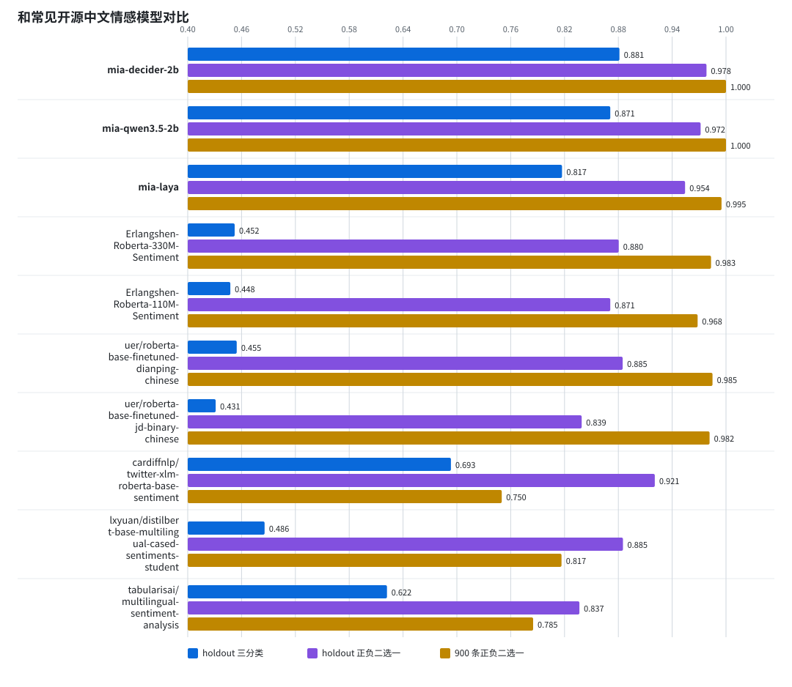

# Mia：中文情感分析模型（正面 / 负面 / 中性）

[](https://huggingface.co/leafiy/mia-decider-2b)
[](https://modelscope.cn/models/leafiy2/mia-decider-2b)
[](#许可)

Mia 是一组自己训练的中文情感分析模型。给它一段中文，它判断作者的态度是正面、负面还是中性，并给出三类各自的概率。从商品评论、微博帖子到问卷开放题和客服对话，都能直接用。权重全部以 Apache-2.0 开源，Hugging Face 和 ModelScope 都能下载。

同系列还有多维情绪识别、情感依据词提取和中文关键词提取三个模型，见[全部模型](#全部模型)。

[English](#english)

## 为什么选 Mia

- **分得出中性。** ModelScope 上下载七十多万次的 StructBERT 情感分类，以及 Hugging Face 上常用的 Erlangshen 和 uer，都只分正负，客观陈述和提问也只能判成一边。Mia 会把这类文本判为中性：5,372 条留出测试上三分类准确率 88.1%，同样能分中性的开源模型最高 69.3%。
- **换个行业照样准。** 一套覆盖 30 个行业、5 种文体的独立测试集（900 条）上准确率 94.0%，开源模型最高 77.7%。
- **概率可信。** 输出的概率经过校准（ECE 0.010），模型说有九成把握的判断，大约九成是对的。拿不准的可以按概率挑出来人工复核。
- **小，跑得快。** 2B 参数，8G 显卡就能跑，RTX 4090 上每秒 375 条；轻量版只有 3.2 亿参数，每秒近 2,000 条。

## 和开源中文情感模型对比

7 个常用的开源中文情感模型和 Mia 用同一套测试、在同一张 RTX 4090 上跑。Mia 没有在下面任何一个公开数据集上训练过。

| 模型 | 类别 | 三分类<br>留出测试 5,372 条 | 三分类<br>30 行业 900 条 | 正负二选一<br>留出测试 | 微博 | 豆瓣影评<br>Macro-F1 | ChnSentiCorp | 网购评论 | eprstmt | 4090<br>每秒条数 |
| --- | --- | ---: | ---: | ---: | ---: | ---: | ---: | ---: | ---: | ---: |
| [**mia-decider-2b**](https://huggingface.co/leafiy/mia-decider-2b) | 负 / 中 / 正 | **0.881** | 0.940 | **0.978** | **0.830** | **0.519** | 0.880 | 0.921 | 0.893 | 375 |
| [**mia-qwen3.5-2b**](https://huggingface.co/leafiy/mia-qwen3.5-2b) | 负 / 中 / 正 | 0.871 | **0.941** | 0.972 | 0.798 | 0.499 | 0.882 | 0.922 | 0.897 | 626 |
| [**mia-laya**](https://huggingface.co/leafiy/mia-laya) | 负 / 中 / 正 | 0.817 | 0.938 | 0.954 | 0.803 | 0.467 | 0.883 | 0.919 | 0.882 | 1,977 |
| [Erlangshen-Roberta-330M-Sentiment](https://huggingface.co/IDEA-CCNL/Erlangshen-Roberta-330M-Sentiment) | 负 / 正 | 0.452 | 0.656 | 0.880 | 0.729 | 0.415 | **0.968** | **0.989** | **0.997** | 1,378 |
| [Erlangshen-Roberta-110M-Sentiment](https://huggingface.co/IDEA-CCNL/Erlangshen-Roberta-110M-Sentiment) | 负 / 正 | 0.448 | 0.646 | 0.871 | 0.721 | 0.409 | 0.962 | 0.979 | 0.982 | 3,809 |
| [uer/roberta-base-finetuned-dianping-chinese](https://huggingface.co/uer/roberta-base-finetuned-dianping-chinese) | 负 / 正 | 0.455 | 0.657 | 0.885 | 0.726 | 0.414 | 0.877 | 0.894 | 0.795 | 3,812 |
| [uer/roberta-base-finetuned-jd-binary-chinese](https://huggingface.co/uer/roberta-base-finetuned-jd-binary-chinese) | 负 / 正 | 0.431 | 0.654 | 0.839 | 0.704 | 0.455 | 0.834 | 0.928 | 0.902 | 3,795 |
| [cardiffnlp/twitter-xlm-roberta-base-sentiment](https://huggingface.co/cardiffnlp/twitter-xlm-roberta-base-sentiment) | 负 / 中 / 正 | 0.693 | 0.664 | 0.921 | 0.813 | 0.397 | 0.809 | 0.894 | 0.848 | 3,650 |
| [lxyuan/distilbert-base-multilingual-cased-sentiments-student](https://huggingface.co/lxyuan/distilbert-base-multilingual-cased-sentiments-student) | 负 / 中 / 正 | 0.486 | 0.560 | 0.885 | 0.797 | 0.447 | 0.852 | 0.903 | 0.864 | 6,699 |
| [tabularisai/multilingual-sentiment-analysis](https://huggingface.co/tabularisai/multilingual-sentiment-analysis) | 五档合为三类 | 0.622 | 0.777 | 0.837 | 0.668 | 0.374 | 0.822 | 0.868 | 0.841 | 6,556 |

- **三分类**是负面、中性、正面三选一。只分正负的模型判不出中性，这两列分数自然低。
- **正负二选一**只比较正、负两类的概率，和只分正负的模型同一个比法。微博、ChnSentiCorp、网购评论、eprstmt 四列也是这个比法。
- 商品和酒店评论的三个集子上 Erlangshen 更高。其中 ChnSentiCorp 平均 100 多字，常常好评差评夹在一起，Mia 的训练文本都在 100 字以内。



逐项数字、测法和全部对照实验见[完整评测与训练记录](docs/report.md)。

## 快速开始

```bash
pip install torch "transformers>=5" "decider-ai>=1.4"
hf download leafiy/mia-decider-2b --local-dir mia-decider-2b
# 国内可以换成 ModelScope：modelscope download --model leafiy2/mia-decider-2b --local_dir mia-decider-2b
```

```python
import json
from decider.infer import Decider

d = Decider('mia-decider-2b/final')
questions = json.load(open('mia-decider-2b/questions.json', encoding='utf-8'))
schema = d.schema(questions)          # 题目只算一次，之后每条只算文本本身

texts = ['这家店的服务真的没话说', '本次记录涉及这家快递网点，相关信息来自页面与服务记录']
for t, r in zip(texts, schema.batch(texts)):
    print(t, r['answers']['sentiment']['choice'], r['answers']['sentiment']['probabilities'])
# 这家店的服务真的没话说 正面 {'负面': 0.0017, '中性': 0.004, '正面': 0.9943}
# 本次记录涉及这家快递网点，相关信息来自页面与服务记录 中性 {'负面': 0.0001, '中性': 0.9998, '正面': 0.0001}
```

输入先做和训练时一样的归一化，用 [`scripts/prepare-laya-sentiment.py`](scripts/prepare-laya-sentiment.py) 里的 `normalize_text`。其余五个模型的用法见各自的模型卡。

## 全部模型

| 模型 | 做什么 | 参数量 | 下载 |
| --- | --- | ---: | --- |
| [`mia-decider-2b`](models/mia-decider-2b/README.md)（推荐） | 情感分析：正面 / 负面 / 中性。留出测试上最准，概率最可信 | 2B | [Hugging Face](https://huggingface.co/leafiy/mia-decider-2b) · [ModelScope](https://modelscope.cn/models/leafiy2/mia-decider-2b) |
| [`mia-qwen3.5-2b`](models/mia-qwen3.5-2b/README.md) | 情感分析，只用 transformers 就能加载，中性认得最准 | 2B | [Hugging Face](https://huggingface.co/leafiy/mia-qwen3.5-2b) · [ModelScope](https://modelscope.cn/models/leafiy2/mia-qwen3.5-2b) |
| [`mia-laya`](models/mia-laya/README.md) | 情感分析轻量版，每秒近 2,000 条 | 322M | [Hugging Face](https://huggingface.co/leafiy/mia-laya) · [ModelScope](https://modelscope.cn/models/leafiy2/mia-laya) |
| [`mia-vad-2b`](models/mia-vad-2b/README.md) | 多维情绪识别：一次给出整体态度、效价、唤醒度、支配度、七类主导情绪和情绪强度 | 2B | [ModelScope](https://modelscope.cn/models/leafiy2/mia-vad-2b) |
| [`mia-evidence-2b`](models/mia-evidence-2b/README.md) | 情感依据词提取：摘出原文里决定态度的词，并判断否定翻转、反讽、让步转折等表达方式 | 2B | [ModelScope](https://modelscope.cn/models/leafiy2/mia-evidence-2b) |
| [`mia-keyphrase-2b`](models/mia-keyphrase-2b/README.md) | 中文关键词提取：摘出最能代表一段材料主题的关键短语 | 2B | [ModelScope](https://modelscope.cn/models/leafiy2/mia-keyphrase-2b) |

## 适合什么文本

- 商品评论、酒店和服务点评
- 微博、论坛和社区帖子
- 问卷开放题和回访记录
- 客服和售后对话
- 舆情监测和品牌口碑跟踪

## 用之前要知道

- 一条里好评差评都有时，Mia 判为中性。只需要正负两类时，比较正面和负面的概率，别直接取三类里最大的那个。
- 训练文本都在 100 字以内，长评论上准确率会下降。

## 详细记录

- [完整评测与训练记录](docs/report.md)：12 次训练和 4 个零样本基线的成绩、公开数据集上的逐项数字、混淆矩阵、数据怎么来的、训练配方和 16 条训练心得
- [六个模型是怎么训出来的](docs/mia-series.md)
- [图表页](docs/index.html)
- `data/eval/`：全部测试集，可以直接拿来测你自己的模型
- `reports/`、`scripts/`、`logs/`：每次实验的报告、脚本和日志

## English

**Mia** is a family of open-weight **Chinese sentiment analysis** models. Give it a piece of Chinese text, such as a product review, a Weibo post, a survey answer or a customer-service chat, and it tells you whether the author is **positive, negative or neutral**, with calibrated probabilities.

- **Handles neutral text.** Many popular Chinese sentiment models only output positive or negative. Mia reaches 88.1% three-class accuracy on a 5,372-text holdout set; the best open three-class model we tested reaches 69.3%.
- **Works across domains.** 94.0% on an independent 900-text benchmark covering 30 industries and 5 genres (best open model: 77.7%).
- **Calibrated probabilities** (ECE 0.010), useful for routing uncertain cases to human review.
- **Small and fast.** 2B parameters, fits an 8 GB GPU, 375 texts/s on an RTX 4090; the 322M lightweight version runs at 1,977 texts/s.
- **More in the family:** multi-dimensional emotion recognition (valence, arousal, dominance, seven emotion categories, intensity), sentiment evidence extraction, and Chinese keyphrase extraction.

Weights: [Hugging Face `leafiy/mia-decider-2b`](https://huggingface.co/leafiy/mia-decider-2b) · [ModelScope `leafiy2/mia-decider-2b`](https://modelscope.cn/models/leafiy2/mia-decider-2b). See [Quick start](#快速开始) for code. All weights are released under Apache-2.0.

## 引用

```bibtex
@misc{mia2026,
  title  = {Mia: Chinese Sentiment Analysis Models},
  author = {leafiy},
  year   = {2026},
  url    = {https://github.com/leafiy/mia}
}
```

## 许可

- 六个模型的权重都以 **Apache-2.0** 发布，与各自的底座一致。
- 底座：`mia-decider-2b` 和 `mia-vad-2b` 基于 [Mapika/decider-2b](https://huggingface.co/Mapika/decider-2b)（Apache-2.0，独立项目，与 TypeSafe AI 无关，底座 Qwen3.5-2B-Base），训练时混入的回放题来自 decider 仓库的 `teacher_data/`（同一许可）；`mia-qwen3.5-2b`、`mia-evidence-2b`、`mia-keyphrase-2b` 基于 Qwen3.5-2B（Apache-2.0）；`mia-laya` 基于 convaiinnovations/laya-multilingual（Apache-2.0），编码器为 jhu-clsp/mmBERT-base。Kev 与 CLM（均为 Apache-2.0）只用于对照，没有进入任何发布权重。
- `mia-vad-2b` 评测用的 CVAT 与 SMP2020-EWECT 不在本仓库里，请按各自发布方的条款下载使用。
- 本仓库的代码、报告与评测数据的许可待定。

## 致谢

Laya（convaiinnovations）、Qwen 团队、jhu-clsp 的 mmBERT、decider（Mapika）、Kev（jaredpalmer）、CLM（Contrastive-LM），以及 ChnSentiCorp、online_shopping_10_cats、eprstmt、weibo_senti_100k、DMSC、CVAT（Chinese EmoBank）、SMP2020-EWECT 这几个公开数据集的整理者。
